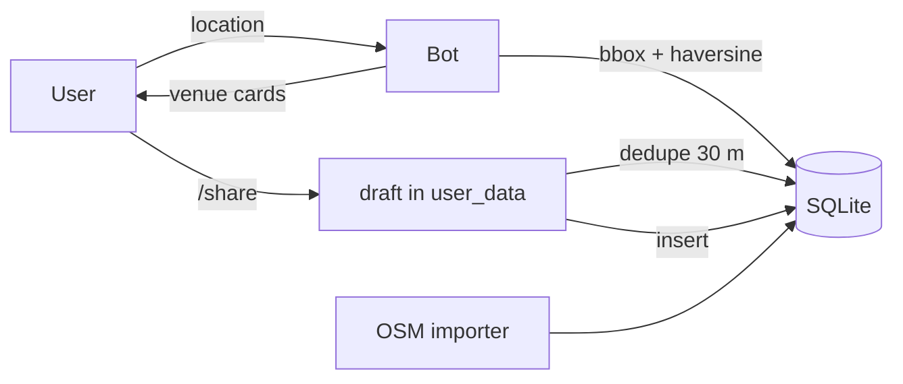

# cheebot

A free Telegram bot for finding public toilets near you — and for adding the ones that are missing.

No accounts, no ads, no tracking. Runs as a single Python process with SQLite, so it costs
roughly nothing to host.

## What it does

|                      |                                                                                                                             |
| -------------------- | --------------------------------------------------------------------------------------------------------------------------- |
| **Find the nearest** | `/nearest`, or tap 📍 Nearest. Search widens automatically if there's nothing close.                                        |
| **View a place**     | Results are native venue cards with a one-tap Directions button.                                                            |
| **Add a place**      | `/share` → send the location → name it (or Skip). Close duplicates are caught and turned into a "same place?" confirmation. |
| **Search by text**   | `/find station`, or tap 🔍 Find.                                                                                            |
| **Share anywhere**   | Inline mode: `@yourbot central station` in any chat.                                                                        |
| **Rate a place**     | Tap 1–5 stars on any card. The average shows on the card; rating again replaces your score.                                 |
| **Manage your own**  | `/mine` lists what you added, with Rename and Delete (delete asks first, then removes it for good).                         |
| **Three languages**  | Burmese by default, plus English and Chinese. Follows the Telegram app's language; `/language` remembers your choice.       |
| **Flag bad data**    | 🚩 Report on every card. Three different users hide a place automatically.                                                  |

## Quick start

```sh
uv sync                    # creates .venv from uv.lock (Python 3.12)
cp .env.example .env       # then paste your token from @BotFather
uv run python -m cheebot
```

The environment is managed by [uv](https://docs.astral.sh/uv/): `.python-version` pins the
interpreter and `uv.lock` pins every dependency, so builds and CI agree with your machine.

Then open your bot, send `/start`, and try `/share` — the database starts empty unless you
seed it (below).

## Seeding with real data

OpenStreetMap already has `amenity=toilets` mapped in most cities. Seed one city at a time:

```sh
uv run python scripts/import_osm.py --city yangon
uv run python scripts/import_osm.py --city bangkok
uv run python scripts/import_osm.py --city all      # every configured city, paced
```

City boxes live in `cheebot/seeds.py`; adding one is a single line. **Seeded so far: 561 toilets —
Yangon (66), Bangkok (486), Mandalay (9).**

Coverage tracks OSM, which is uneven: Bangkok is well mapped, Mandalay barely is. That asymmetry is
the reason `/share` exists — in Myanmar the map will mostly be built by users.

Why city by city: the public Overpass instance restricts automated bulk use, and a city-sized
request goes through where a country-sized one is often rejected for capacity. If you want whole-
country coverage anyway, `--preset thailand` sends one area query — an administrative area is
better than a bounding box there, because a box around Singapore would also import Johor Bahru.
When the instance is at capacity, point `--endpoint` at a mirror (the script also retries
429/5xx with backoff):

```sh
uv run python scripts/import_osm.py --city bangkok \
  --endpoint https://overpass.kumi.systems/api/interpreter
```

Re-running is always safe: rows match on `osm_id` and are updated in place, so cities can be
refreshed as OSM changes. Toilets tagged `access=private` or `access=no` are skipped — they aren't
places a visitor can use. Attribution to OpenStreetMap and the ODbL is included in `/about`; keep it.

## Commands

| Command        | Description                                      |
| -------------- | ------------------------------------------------ |
| `/start`       | Welcome screen and the persistent keyboard       |
| `/nearest`     | Ask for a location, list the closest toilets     |
| `/share`       | Add a toilet (location → duplicate check → name) |
| `/find <text>` | Search by name or address                        |
| `/language`    | Switch between Burmese, English and Chinese      |
| `/mine`        | Rename or delete places you added                |
| `/skip`        | Finish adding a place without naming it          |
| `/cancel`      | Abandon the current flow                         |
| `/about`       | Data sources and privacy                         |
| `/help`        | Usage summary                                    |

## How it works

**Languages.** Burmese (`my`) is the default, with English (`en`) and Chinese (`zh`) alongside. The
bot picks one in this order: the choice saved with `/language`, then the Telegram client's own
language, then `CHEEBOT_DEFAULT_LANGUAGE`. Copy lives in `cheebot/i18n.py`, one dict per language;
`tests/test_i18n.py` fails if a translation is missing a key or a `{}` placeholder. Button taps are
matched in all three languages, so switching never leaves an older keyboard dead.



**Nearest search.** A bounding box on `(lat, lon)` narrows candidates using the index, then
haversine ranks them exactly inside the circle. No PostGIS, no external geocoding. Fine well past
100k rows; the antimeridian wrap is handled.

**Conversation state.** The share flow keeps its draft in `context.user_data`, not the database,
so an abandoned flow leaves no half-written rows. Updates are processed one at a time, which keeps
that state predictable.

**Duplicate detection.** A submission within `CHEEBOT_DEDUPE_RADIUS_M` of an existing toilet
doesn't get silently rejected. The bot shows the existing entry and asks whether it's the same
place — a confirmation if yes, a new row if no. Typos become data instead of being thrown away.

## Data model

`toilets` — the map itself. `is_free` / `is_accessible` are tri-state (`1`, `0`, `NULL` = unknown),
`status` is `active` or `hidden`, `source` is `user` or `osm`, `added_by` is a salted hash that also
makes a place "yours" for `/mine`.

Deleting owns nothing extra: `/mine` issues `DELETE ... WHERE id = ? AND added_by = ?`, so ownership is
enforced by the statement, not by trusting the callback id. Ratings and reports cascade with the row.

`reports` — one row per user per toilet (`UNIQUE`), so repeat taps can't bury a place.

`ratings` — one 1–5 score per user per toilet (`UNIQUE`), stored as `sha256` user hashes. Rating
again overwrites the previous score instead of adding a row, so the average tracks people rather
than taps. Averages are computed on read (`AVG`/`COUNT`), so there is nothing to keep in sync.

`user_languages` — the language each user last picked, keyed by the same salted hash. One row per
user who has used `/language`; everyone else is detected per request and never stored.

`submissions` — an append-only log used for the daily per-user rate limit.

Schema changes are additive and run in place at startup, tracked by `PRAGMA user_version`. An
existing database is migrated forward (v1 → v2 adds `ratings`) without touching its rows.

## Privacy

- The location you send is used for one query and never stored.
- User ids are not stored; only `sha256(SALT + id)[:32]`, which is used for rate limits,
  duplicate-report detection, one-rating-per-user and remembering your language. Set a real
  `CHEEBOT_USER_HASH_SALT` in production.
- Places you add are public by design. You can rename or delete them any time with `/mine`.

## Deploying

```sh
docker build -t cheebot .
sudo mkdir -p /srv/cheebot && sudo chown 1000:1000 /srv/cheebot   # uid the container runs as
docker run -d --name cheebot --restart unless-stopped \
  --env-file .env -v /srv/cheebot:/data cheebot
```

Long polling means no public HTTPS endpoint, reverse proxy or TLS certificate — any small VM or
container host that can run a background process works.

### Persisting the data

All state is one SQLite file at `CHEEBOT_DB_PATH` (`/data/cheebot.db` in the container; ~200 KB per
thousand toilets). Persistence is therefore just "keep `/data` on a real disk":

| Setup                                  | Survives                                  | Notes                                                                                                                          |
| -------------------------------------- | ----------------------------------------- | ------------------------------------------------------------------------------------------------------------------------------ |
| `-v /srv/cheebot:/data` (bind mount)   | container recreate, image rebuild, reboot | **Recommended on a VM.** Plain files you can inspect, copy and back up.                                                        |
| `-v cheebot-data:/data` (named volume) | container recreate, image rebuild         | Fine, but you need `docker cp` or a helper container to read it. Lost to `docker volume rm` / `docker system prune --volumes`. |
| no `-v` at all                         | `docker restart` only                     | Docker makes an _anonymous_ volume, which disappears with `docker rm`. Don't rely on it.                                       |

The bind-mount gotcha is permissions: the container runs as an unprivileged user, so the host
directory must be writable by that uid (`docker exec cheebot id -u`, normally `1000`).

**If the host disk is ephemeral** — most free PaaS tiers (Render, Koyeb, Cloud Run, Railway without a
volume) — every deploy starts from an empty filesystem and user submissions die with it. Those hosts
need a persistent volume add-on, usually paid. A small VM with a bind mount is the cheapest setup
that actually keeps the data, which is what the command above assumes.

SQLite runs in WAL mode, so seeding or backing up while the bot is live is safe.

### Seeding on the server

The image ships `scripts/`, so you can fill the database in place, one city per Overpass request:

```sh
docker exec -it cheebot python scripts/import_osm.py --city yangon
docker exec -it cheebot python scripts/import_osm.py --city bangkok
```

Seeding locally and copying is just as good — it's a single file (`scp cheebot.db
server:/srv/cheebot/cheebot.db`), no dump and restore.

### Backing up

Use the script, not `cp`: in WAL mode the newest writes may still be in the `-wal` sidecar, and a
plain copy would miss them. `backup_db.py` uses SQLite's online backup API, so it is safe while the
bot is serving users.

```sh
docker exec cheebot python scripts/backup_db.py --out /data/backups/cheebot-2026-11-12.db
```

A cron entry is enough:

```cron
0 3 * * * docker exec cheebot python scripts/backup_db.py --out /data/backups/cheebot-$(date +\%F).db
```

Restore by stopping the bot and copying the backup back to `CHEEBOT_DB_PATH`. Since the volume holds
plain files, copying the whole `/srv/cheebot` directory elsewhere is a complete backup too.

The importer needs outbound access to `overpass-api.de`; the bot itself only needs `api.telegram.org`.

## Configuration

All settings are environment variables; see `.env.example`. The ones that change behaviour:

- `CHEEBOT_DEFAULT_RADIUS_M` / `CHEEBOT_MAX_RADIUS_M` — where the search starts, and how far it
  will widen before giving up (1 km → 25 km by default).
- `CHEEBOT_DEDUPE_RADIUS_M` — how close a new pin must be to trigger the duplicate prompt.
- `CHEEBOT_REPORT_HIDE_THRESHOLD` — reports from different users needed to hide a place.
- `CHEEBOT_DAILY_SHARE_LIMIT` — places one user may add per 24 h.
- `CHEEBOT_DEFAULT_LANGUAGE` — `my` (Burmese, the default), `en` or `zh`. Only a first guess: each
  user's own choice wins.
- `CHEEBOT_OVERPASS_URL` — default endpoint for the seeding script.
- `CHEEBOT_LOG_LEVEL` — `DEBUG` when running locally, `INFO` otherwise.
- `CHEEBOT_DROP_PENDING` — drop updates queued while the bot was offline.

## Local development

Three loops, cheapest first.

### 1. Tests — half a second, no token, no network

```sh
uv run pytest                                    # everything (222 tests)
uv run pytest tests/test_flows.py -k duplicate    # one flow
uv run pytest --looponfail                       # re-run on save
uv run ruff check                                # lint (rules live in pyproject.toml)
```

They cover the geo maths (antimeridian, poles), every query in `repo.py`, the handler flows end to
end (share, duplicate detection, reports, ratings, inline mode, deep links, the language switch,
owning and deleting your own places) against real `Update` objects, the OSM tag mapping, the backup
path, and the simulator's own routing — with only the network boundary mocked.

### 2. Conversation simulator — the real dispatcher, no Telegram

```sh
uv run python scripts/dev_sim.py --db dev.db
```

This runs the actual `Application` — same handlers, same filters, same routing — and prints what the
bot would send, including the callback data behind every button:

```
you │ /share
  bot │ ➕ Add a toilet
  bot │ Send me the location of the toilet. Standing next to it gives the best pin …
     keyboard: 📍 Send the toilet's location | ✖️ Cancel
you │ loc 16.7748 96.1583
  bot │ This looks like a place that's already on the map, about 10 m away:
     [✅ Same place → cb dup:same:23]  [🆕 It's different → cb dup:new]
you │ cb dup:new
  bot │ Got it. What's this place called?
```

| Input                           | Effect                                               |
| ------------------------------- | ---------------------------------------------------- |
| `/start`, `/nearest`, `/find x` | send that command                                    |
| `loc <lat> <lon>`               | share a location                                     |
| `cb <data>`                     | press an inline button (the data is printed for you) |
| `inline <query>`                | run an inline query                                  |
| `count`                         | rows in the database                                 |
| `quit`                          | leave                                                |

It needs no token, and it deliberately refuses to inherit one from `.env` — a dev tool shouldn't be
able to carry a production secret into a traceback.

Seed the dev database the same way as production:

```sh
uv run python scripts/import_osm.py --city yangon --db dev.db
```

### 3. A real bot — for what a simulator cannot show

Keyboard layout, inline mode, location sharing and deep links only behave correctly in Telegram.

**One-time setup in @BotFather** (use a _separate_ dev bot so test traffic never touches production
data):

1. `/newbot` → name + username → copy the token.
2. `/setinline` → enable inline mode, otherwise `@yourbot query` does nothing.
3. `/setcommands` → paste the menu:

```
start - Show the menu
nearest - Closest toilets to me
share - Add a toilet
find - Search by name or area
mine - Rename or delete places I added
about - Data sources and privacy
language - Change the language
help - How to use
cancel - Stop what you're doing
```

**Run it:**

```sh
cp .env.example .env      # if you have no .env yet
# put the token + a random CHEEBOT_USER_HASH_SALT in .env
export CHEEBOT_DB_PATH=dev.db
uv run python -m cheebot
```

A good startup looks like this — it confirms the token before polling, so a typo fails in one line
instead of a traceback:

```
INFO     cheebot: connected as @cheebot_dev — polling (db=dev.db, pid=48213)
INFO     cheebot: send /start to me in Telegram to try it; Ctrl-C to stop
```

Then open `t.me/<yourbot>`, hit Start, and send `/nearest`. Ctrl-C stops it.

**Things that only bite when running for real:**

- **Only one process may poll a token.** If the bot is also running on your server, the local one dies
  with `Conflict` — Telegram keeps a single `getUpdates` consumer per token. A separate dev bot avoids
  this entirely.
- **Share location from a phone.** Desktop clients are unreliable about the `request_location` button;
  the nearest-toilet flow is best tested on iOS/Android.
- **Local data is not production data.** Point `CHEEBOT_DB_PATH` at a dev file and seed it
  independently:
  ```sh
  uv run python scripts/import_osm.py --city yangon --db dev.db
  ```
- **`CHEEBOT_LOG_LEVEL=DEBUG`** shows every API call when a handler misbehaves, and
  `CHEEBOT_DROP_PENDING=true` skips the messages that queued up while you were offline.

## Not built yet

Deliberately out of scope for v1, in rough priority order:

- A moderation view for hidden toilets (right now they're only visible in the database).
- Localisation — all copy is in `cheebot/texts.py` and ready to be keyed.
- Postgres/PostGIS, if a single city ever outgrows SQLite.
- Photos and opening hours per toilet.
